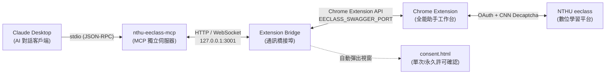

# NTHU eeclass MCP Server

[](https://opensource.org/licenses/MIT)
[](https://nodejs.org/)
[](https://modelcontextprotocol.io/)

專為**國立清華大學數位學習平台 (NTHU eeclass)** 與 **Claude Desktop** 設計的獨立 Model Context Protocol (MCP) 伺服器。

透過自然語言與 Claude 對話，即可直接在 eeclass 完成**智慧出作業、批改學生作答、發布課程公告、清查未交催交、批次匯入成績與教材下載**，並內建高規格的**身分權限劃分與雙軌制操作授權許可視窗 (Consent Dialog)**。

---

## 🏛️ 架構設計 (Architecture)

本專案與 Chrome 擴充套件採**完全解耦架構 (Decoupled Design)**，透過本地迴路橋接埠 (`127.0.0.1:3001`) 進行實體通訊與授權確認：



---

## 🚀 快速安裝至 Claude Desktop

### 1. 安裝依賴套件

```bash
cd C:\Users\user\code\nthu-eeclass-mcp
npm install
```

### 2. 配置 Claude Desktop 設定檔

開啟 Claude Desktop 設定檔：
- **Windows**: `%APPDATA%\Claude\claude_desktop_config.json`
- **macOS**: `~/Library/Application Support/Claude/claude_desktop_config.json`

在 `mcpServers` 區塊加入以下配置（建議使用 Node.js 絕對路徑）：

```json
{
  "mcpServers": {
    "nthu-eeclass-mcp": {
      "command": "C:/nvm4w/nodejs/node.exe",
      "args": [
        "C:/Users/user/code/nthu-eeclass-mcp/index.js"
      ]
    }
  }
}
```

> **提示**：若使用全域 `node`，可將 `command` 設為 `"node"`。

### 3. 重啟 Claude Desktop

完全退出 Claude（在 Windows 右下角系統匣點擊右鍵 -> **Quit Claude**），然後重新開啟應用程式。在對話框右下角點擊 🔨 圖示，即可看到 **37 項** 完整的 eeclass 工具！

---

## 🛡️ 核心安全防護機制

### 1. 課程身分權限自動劃分 (Course Role Classifier)
- 登入時自動掃描使用者所有課程：
  - **助教／授課教師課程 (`teachingCourses`)**：開放作業 CRUD、評分、試卷管理、公告發布。
  - **一般修課學生課程 (`studentCourses`)**：僅開放瀏覽、下載講義、個人繳交。
- **身分守衛**：若在一般學生課程嘗試出作業或改成績，系統直接阻擋並明確警示無助教權限。

### 2. 雙軌制操作授權許可視窗 (`consent.html`)
- **單次許可 (One-time Consent)**：核發單次使用之 Token，執行完畢即銷毀。
- **永久許可 (Permanent Consent)**：記住該課程之該動作，日後自動放行無需重複確認。
- **詳細資料檢視 (Payload Inspector)**：在 Chrome 彈出的官方紫色視窗中，明確展示即將寫入之學號、分數、評語草稿、公告主旨等完整內容，保障資料變更安全。

### 3. 破壞性操作零容忍防呆
- **作業刪除**：僅限未有繳交者 (`submittedCount === 0`)。已有繳交者嚴格禁止刪除。
- **測驗刪除**：僅限未有作答者 (`testedCount === 0`)。已有作答者嚴格禁止刪除。

---

## 🧰 完整工具清單 (37 項 Tools)

| 工具名稱 | 類別 | 功能說明 | 授權約束 |
|---|---|---|---|
| `check_extension_and_setup_status` | 環境引導 | 檢測 Chrome、外掛載入與密碼設定，未就緒時自動開啟引導精靈 | 自動開啟精靈 |
| `wake_and_bootstrap_eeclass` | 喚醒登入 | 喚醒擴充套件進行自動驗證碼登入，並掃描劃分 TA/學生課程身分 | 身份核心 |
| `get_classified_courses` | 課程權限 | 取得助教/老師課程與學生課程之劃分清冊 | 唯讀 |
| `request_action_consent` | 授權管理 | 向擴充套件申請操作許可（支援單次許可與永久許可模式） | 授權彈窗 |
| `list_granted_consents` | 授權管理 | 查詢目前生效之單次 Token 與永久授權清冊及追蹤身分 | 唯讀 |
| `revoke_permanent_consent` | 授權管理 | 撤銷特定或全部課程之永久操作許可，恢復逐次彈窗確認 | 授權重置 |
| `ensure_chrome_eeclass_session` | 瀏覽器狀態 | 檢查 Chrome 與 eeclass 登入狀態，未啟動時自動喚醒瀏覽器 | 系統狀態 |
| `download_course_materials` | 學生下載 | 下載指定課程之課堂教材至自訂資料夾，並驗證外掛收訖 (ACK) | 外掛實體驗證 |
| `verify_extension_mcp_sync` | 系統驗證 | 驗證 Chrome 擴充套件是否確實收到來自 MCP 之通訊資料 | 實體驗證 |
| `get_user_permissions` | 權限鑑權 | 查詢使用者目前之系統角色與資料操作權限分類 | 唯讀 |
| `request_ui_consent` | 權限鑑權 | 申請高危險操作之單次使用者 UI 許可權杖 (X-Consent-Token) | 單次 Token |
| `list_teaching_courses` | 基礎課程 | 取得助教/老師的所有課程代號、ID 與授課教師名單 | 唯讀 |
| `get_course_sidebar_info`| 基礎課程 | 取得側欄師資名單、助教名單與當前身份 | 唯讀 |
| `list_homeworks` | 作業管理 | 列出作業清單、繳交統計與 `canDelete` 安全刪除標記 | 唯讀 |
| `get_homework_detail` | 作業管理 | 取得作業詳細規範（成績比重、遲交規則、評分方式） | 唯讀 |
| `create_homework` | 作業管理 | 新增個人、分組或 AI 作業 | 需助教身分 + 許可 |
| `delete_homework` | 作業管理 | 刪除作業 | **僅限 0 人繳交，需 UI 許可** |
| `list_homework_submissions` | 作業批改 | 取得已交/未交/退回重寫名單與學生繳交作答文字 | 唯讀 |
| `package_download_homework` | 作業批改 | 取得作業附件與文字檔打包 ZIP 下載連結 | 唯讀 |
| `audit_homework_submission` | 作業批改 | 填寫學生分數、富文字評語、值得觀摩與寄信通知 | 需助教身分 + 許可 |
| `reject_homework_submission` | 助教特殊 | 退回學生作業並送達重寫通知與修改指示 | 需助教身分 + 許可 |
| `copy_homework` | 助教特殊 | 快速複製既有作業為範本建立新作業 | 需助教身分 + 許可 |
| `list_unsubmitted_students` | 助教特殊 | 清查未交名單並支援一鍵排程寄發催交提醒信 | 可選發信通知 |
| `import_grades_csv` | 助教特殊 | 批次匯入成績與評語清單（覆寫成績） | **高風險：需 UI 許可** |
| `list_exams` | 測驗管理 | 列出測驗列表（含 examId 與作答 kexamId） | 唯讀 |
| `delete_exam` | 測驗管理 | 刪除測驗 | **僅限 0 人測驗，需 UI 許可** |
| `copy_exam` | 助教特殊 | 複製測驗試卷與題庫設定建立新測驗 | 需助教身分 + 許可 |
| `delete_student_exam_attempt` | 助教特殊 | 刪除學生作答紀錄允許其重新測驗（斷線重考） | **高風險：需 UI 許可** |
| `get_exam_record_detail` | 測驗批改 | 取得學生作答明細（分離選擇題自動批改與問答題）| 唯讀 |
| `audit_essay_question` | 測驗批改 | 人工問答題填入分數與富文字評語 | 需助教身分 + 許可 |
| `list_bulletins` | 公告管理 | 取得課程公告清單 | 唯讀 |
| `create_bulletin` | 公告管理 | 發布新公告（支援重要置頂、草稿、起訖日） | 需助教身分 + 許可 |
| `copy_bulletin` | 助教特殊 | 複製既有公告內容快速重新發布 | 需助教身分 + 許可 |
| `send_bulletin_mail_notification` | 公告管理 | 寄信通知全體修課生（全體廣播郵件） | **高風險：需 UI 許可** |
| `ai_generate_homework_assignment` | AI 輔助 | **AI 智能出題與規準 Rubric 生成器** | 生成作業規準 |
| `ai_compose_bulletin_announcement` | AI 輔助 | **AI 智能撰寫並發布課程公告** | 支援多種公告語氣 |
| `ai_assist_grading_feedback` | AI 輔助 | **AI 智能批改輔助與建議給分** | 富文字建設性評語 |

---

## 🧪 自動化測試 (Automated Tests)

執行完整整合測試以驗證全部 37 項工具與通訊協議：

```bash
npm test
```

---

## 📄 授權條款 (License)

本專案採用 [MIT License](LICENSE) 授權。
